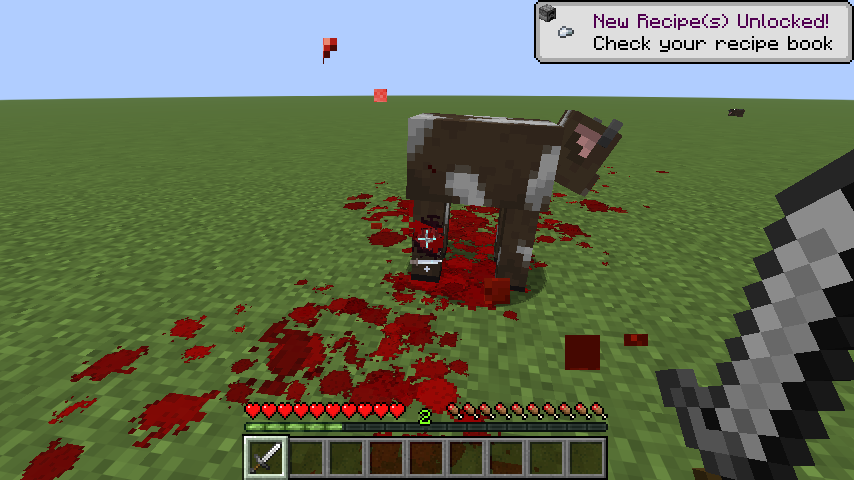
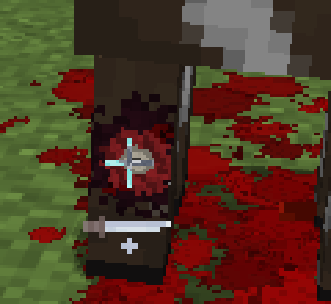
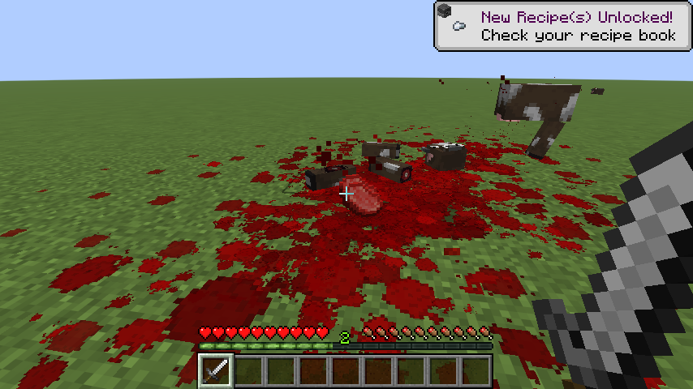
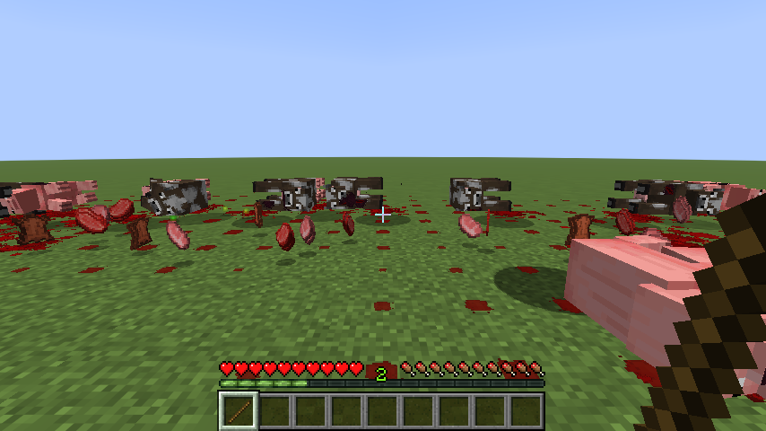
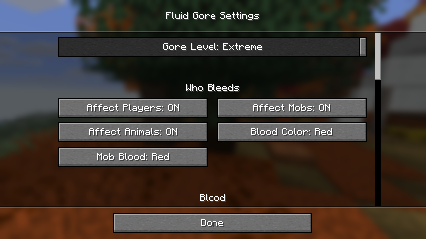

# Fluid Gore

**Silver-age Minecraft as a butcher's yard.** Fluid Gore is a Fabric mod for Minecraft Java **26.3**. It gives every
blow weight and every animal a death of its own. Wounds open where you strike and deepen with each blow, limbs and
heads come off, and blood sprays, pools and runs downhill. Animals scream, panic, grieve and remember.

It is built from the game's own pieces: vanilla sounds and particles, pixel-art blood, and wounds, bones and organs
drawn at the size of the model's own pixels. It should feel like part of the game, not a horror pack on top of it.

> **Content note:** this mod shows graphic violence against animals, on purpose. At Extreme it shows plainly what a
> kill costs the animal. The Gore Level and Suffering sliders scale it down to something mild, or switch it off.



## Where it runs

| Setup | What you get |
|---|---|
| **Client only**, on any server (vanilla included) | All of the visual gore. Nobody else needs the mod. Players who have it see the same wounds, severed parts and deaths (see [Multiplayer](#multiplayer)). Nothing in the world changes: health, damage, drops, loot, AI and game rules are untouched. |
| **On the server too** (singleplayer, a LAN world you host, e4mc, a Fabric server) | Everything above, plus bodies that stay where they fell, exact server-reported hits, shared butchery and rot, bloody cleaning tools, burning bodies that spread fire. Fluid Gore registers no blocks, items or entities, so the server does not force it on players who join. |

What the server half changes in the world, and nothing else:
- A slaughtered animal's body stays as an entity until it is cleaned up, butchered apart or cleared away with
  `/fluidgore clear` (operators only, see [Demos](#demos)). Its drops and experience still come out when it dies, as
  in vanilla. A dead body cannot be milked, sheared, fed, leashed or ridden, and bodies do not count towards the mob
  cap. Where it ends up after a fall comes from the nearest player's game when that player has Ragdoll Physics on
  (see [Multiplayer](#multiplayer)).
- A sponge or brush used on blood gets stained (a model tint on that item), and a sponge washed clean becomes a wet
  sponge.
- An animal running on fire, or a body that died burning, can light vanilla fire. The
  `fire_spread_radius_around_player` game rule still applies (Burning Bodies Spread Fire, on by default).
- With the separate Cobble Tank mod installed, the tank does real damage (see [Cobble Tank](#cobble-tank-separate-mod)).

## Features

### Wounds where you strike
Each blow is tested against the animal's actual model, not its hitbox, and lands where you aimed: a leg, the neck, the
head, the flank. Blows to the same spot deepen the wound through four layers: **bruise, gash, open meat, bone**.
Wounds are drawn on the model, so they move with every step, on living animals mid-fight and on bodies after death.
Open wounds drip, so a wounded animal leaves a trail. How deep a wound can go depends on the Gore Level.



- **Weapons cut differently.**
  - Fists and clubs bruise and crush but barely break the skin, so a beating bleeds little on the outside. After
    enough of it the animal bleeds from the mouth and nose instead.
  - Flint scrapes ragged, shallow cuts. Swords cut, and axes chop deep and wide.
  - A pickaxe digs in and knocks out bits of fat, meat and bone.
  - Arrows and spears punch small, deep holes, and animals bite.
  - Each weapon has its own sound.
- **Slashes follow the swing.** Swords, axes and flint leave long, narrow cuts laid along the swing, gaping in the
  middle and tapering at the ends. As they deepen they show the bruised edges, the yellow fat under the skin, the
  muscle, and a line of bone. Fists, clubs, points and teeth leave round, ragged wounds.
- **Wounds open into the body.** On a sheep, what shows in a wound is what lies under it: each cut or blow is a window
  onto the animal's own anatomy at the depth it has reached, half-pixel by half-pixel. A cut in the flank shows the
  belly wall's layers, then the wall of the rumen behind them, and cud comes out; a cut over the ribs behind the
  shoulder shows muscle, then rib, then lung, and the blood at the wound froths with air. A sheep with a lung wound dies
  coughing blood from the mouth and nose. Pigs, cows and other animals keep the
  stock picture of fat, meat and bone until they have anatomy of their own.
- **Sticking.** A sword or a flint to the head of a pig, cow, sheep or other four-legged animal goes into its throat:
  a short cut along the underside of the neck, just ahead of the breastbone. The animal bleeds out through it.
- **Blood runs.** Blood from an open wound runs down the skin below it and dries where it ran. A stuck pig pours down
  its chest and the fronts of both forelegs. Once a body lies down, what still bleeds runs across the side it lies on.
- **Pallor.** Skin goes pale as a body loses blood. A bled-out pig lies a washed-out, pale pink beside one that never bled.
  It shows most on pigs and shorn sheep; a cow's or horse's coat hides most of it, and wool keeps its colour. The colour
  comes back as an animal heals. The **Pallor** setting (on by default) turns it off.
- **Bruises.** A blow that does not break the skin leaves a soft red flush, which darkens as the blood in it goes stale.
- **Hack it off.** A blade through a wound that cannot get any deeper takes off that limb or the head. The body keeps
  a raw stump, and the piece keeps its gashes and shows meat around bone where it was cut.
- **Broken bones.** Blunt blows break skulls, ribs and limbs, with visible fractures and bone shards. Repeated blows
  smash a head in or tear a limb off.
- **Flesh by species.**
  - Ordinary animals bleed red.
  - Zombies, drowned, zombified piglins, zoglins and zombie horses are rotting meat: marbled skin, grey waxy fat,
    black-brown ooze, pus and maggots, and dark, slow blood with no pulse behind it.
  - Husks are dried leather that splits onto a sickly ooze.
  - Skeletons never bleed: they crack, chip into shards and shatter.
  - Endermen bleed glowing violet, and their severed limbs teleport about for a while.
  - Pork, beef, mutton and chicken each have their own cut faces.



### Deaths
- **The vanilla death, made gory (default).** An animal goes red and keels over onto its side in a second, its heart
  pumping blood out as it lies still. It falls away from the blow. A sword turns it with the swing and throws blood
  off the slash, and an axe buckles its legs for a moment before it goes over.
- **Death Throes (optional).** Every animal drops the moment it is killed and dies on the ground over three to five
  seconds. First comes a rigid phase, then paddling that fades, a few gasps further and further apart, and stillness.
  The heart pumps blood from the worst wound in beats that weaken until it stops. The cause shapes the death:
  - a head blow is silent and the legs paddle hard;
  - a broken back leaves the hind end dead;
  - a beheaded body kicks hardest and never breathes;
  - a burnt body draws its limbs in.

  No two deaths play out the same way.
- **Chickens die like chickens.** They flap themselves across the ground, shedding bloody feathers. A wrung neck
  flops, and a headless bird flaps longest.
- **Bodies stay and settle.** A body is thrown along the killing blow. It slides down stairs and off ledges, and it
  can still be struck, shoved and cut where it lies. Bodies that fall together come to rest side by side, against each
  other rather than through each other. Walking through a pile of bodies slows you down. One death in
  twenty ends with the body bursting apart (Death Pop).
- **Ragdoll Physics (experimental, off by default).** Dead bodies go limp, with the head, trunk and legs jointed
  within natural limits. They fold and drape over steps and edges, tumble down stairs, and stay on their side of a
  fence. A four-legged animal that dies on its side sets with its legs locked straight out from the trunk, as a
  carcass lies on a killing floor. A body carries its weight as the animal does, not as its blocks are sized: most of
  it is in the trunk, and the head and legs are light. A body that goes over an edge falls trunk first with its legs
  swinging loose, keeps its momentum and tumbles on down a slope or a flight of steps until it lies flat.
  `/gore demo tumble` shows it.

### Animals that react
No messages and no lectures. The world responds instead.
- **Every animal is an individual.** Its species and identity fix its voice pitch, how loud and long it screams, how
  quickly it panics, and whether it is stoic or frantic. Screams are built from each animal's own vanilla sounds,
  pitch-bent and layered into cries, whimpers, gurgles and bellows.
- **The herd notices.** Animals near a slaughter tremble, look around wildly and bellow, and it gets worse with every
  kill. For the rest of the session survivors cower, keep their distance and stand over the bodies. Wolves and foxes
  take an interest in fresh blood, and bodies draw flies.
- **Mothers and their young.** Hurt a calf and it cries for its mother. She answers: her head comes up and turns to
  the cries. A dying calf keeps calling, weaker each time, until it stops. After a moment of silence the mother starts
  to call. She grieves for minutes, head hung and turned to where it happened, calling less often as time passes.
  Kill a mother and her calf is left calling for her. Killing the young weighs on the herd longer than killing an
  adult.

All of this is pose, sound and particles. The animals' actual AI and behaviour are not changed.



### Blood
- **It behaves like a fluid.** Droplets fly with gravity and splat on floors and walls. Puddles flow to lower ground,
  pool in dips, run down stairs and drip off ledges. Arterial spurts pump in pulses.
- **It shows what happened.** Blood that lands at a slant stretches into a teardrop pointing the way it flew. A
  bleeding body that is dragged or shoved smears a trail.
- **It lies where it can.** Blood on a fence rail, a wall top or a pane leaves a thin line along it, and the rest runs
  off and drips to the ground below.
- **It ages and washes away.** Blood lands bright scarlet, darkens to the deep red of standing blood, then dries
  brown-black. A big bleed lies as one pool that stops spreading while still thick. Rain washes it away, and anything
  walking through a puddle leaves footprints.
- **It gets on the animals.** Every animal that bleeds carries blood on its coat, part by part. Its own wounds stain
  it, a blow spatters the animals standing near on the side that faced it (low on their legs, high on their heads),
  and a body blown apart spatters everything round it. Standing in a pool reddens the feet, walking through it
  splashes up the legs, and lying in it soaks the whole body. Bodies lying against each other smear each other:
  the blood on one comes off on the flank of the next. Blood on a coat dries darker, and water rinses it off. A
  leg or head cut off keeps the blood that was on it.
- **Wool and feathers drink it.** A fleece takes far more than hide: the pool under a sheep shrinks as it soaks in,
  and the red climbs the wool of its legs above where it touched. Blood on the body reddens the whole fleece. Chicken
  feathers redden around wounds. Rain and water wash wool and feathers out slowly.
- **It clouds in water.** Blood that reaches water billows out into a dark red cloud that sinks slowly, drifts with
  the current and thins away, longer the more blood went in. A body bleeding in water feeds one growing cloud.
  Pieces in water sink or float by what they are made of: lungs, full of air, and fat float; bone goes to the
  bottom, and meat and organs sink after it more slowly. The current carries them.
- **Cleaning up.** Hold use with a sponge or brush to scrub blood away. The tool soaks up what it takes and goes red
  in three stages. The bloodier it is, the less it lifts and the more it smears, and guts on the floor get squashed
  into dark streaks. Use it on water, a water cauldron, or while standing in water to rinse it. Sneak to use the item
  normally.

### Explosions
A blast is graded by how close each body was and how much of the blast it was exposed to. Each explosion is matched
to a charge size that reproduces vanilla's own lethal range. Each body, and each bone and organ inside it, is graded
by the blast pressure where it is. The side facing the charge comes apart first, and the body shields what is behind
it. A cow and a block of TNT:
- **On top of it:** the cow is blown apart into its own ribs, femurs, lungs, heart, liver and stomach. Every piece is
  thrown and tumbles as it flies, and the side that took the fireball is seared.
- **About 3 m away:** the legs facing the blast are torn off and the belly bursts.
- **About 5 m away:** it dies whole.
- **8 to 12 m away:** it lives, with its ears bleeding.

A body already lying dead takes the same wave. Close to the charge it is shredded or torn open, a little further off
it is thrown limp, and a pressure vessel's fragments go into it where they strike.

**Under water** a charge plays out differently. There is no flame and no scorch, and nothing is seared. Its gas swells
into a bubble that the water crushes back down; it rebounds and rises, and a bubble that reaches the surface bursts out
in white spray. The water rushes out and back with the bubble, and pieces, bodies and blood clouds are carried with it.
A body inside the bubble is torn apart, and its blood clouds out in the water. Further off, the shock carries through
the water much further than through air, but it passes through solid flesh and tears only what holds air: a body
well beyond vanilla's blast range bleeds from the mouth from torn lungs. Shallow water weakens the shock more than deep
water.

Wet pieces smear the walls they hit, and some stick there before they peel off and drop. Players caught close enough
are left deaf for a while, with ringing ears. Blast gore starts at the Medium gore level and covers players too when
the blast kills them.

### Fire
- **Burnt Bodies.** Animals on fire char from seared to roasted to black and stay that way, alive or dead. Fire sears
  wounds shut.
- **Burning Bodies.** Set a dead body alight (flint and steel, a fire charge, fire, a campfire or lava) and it burns
  on its own fat down to a charred skeleton. A heavier body burns longer and smokier. Water puts it out, and blows
  knock off the char and break the bones.
- **Burning People.** Players have an inside, built at the skin's own pixel size: a layer of fat, the muscles, a
  full skeleton and the organs where they lie. Catch fire and it burns down through them pixel by pixel. Clothes and
  hair go first, then the skin blisters, chars and splits onto fat, muscle and bone. How deep it goes depends on the
  gore level and how close the fire has brought you to death, and burns heal as health comes back. Die on fire and
  the body stays and burns on to a skeleton, even after you respawn. Zombies and other humanoid mobs can burn the same
  way (Burning Mobs Too, off by default, because zombies burn every dawn).
- **Burning Animals.** Sheep, pigs and cows burn through their own anatomy: a sheep's hard white suet over dark
  mutton, a pig's soft lard over pale pork, a cow's yellow fat over red beef. A fleece hardly flames: it smoulders,
  chars and falls away in patches, sparing the skin under it for a while. Hooves and horns char but stay.

### Anatomy, remains and butchery
- **A whole animal inside.** A sheep carries its full anatomy: skeleton and spinal cord, heart and great vessels,
  lungs and windpipe, the four stomachs, liver, kidneys, spleen, intestines, the glands (thyroid, thymus, adrenals,
  pancreas, salivary glands) and the caul fat. About half of all sheep are rams and half ewes, each with its own
  reproductive organs (a ewe's udder and uterus, a ram's testes), and every player sees the same animal. A lamb has
  milk teeth, a big thymus and the stomachs of a suckling lamb. Under its skin it has its own body wall: the hide, the white fat under it and
  its named muscles (the eye of the loin, the fillet, the chump, the shoulder, the leg and the cheek, the flank in
  its layers), and its legs carry their own bones, tendons, muscles and hooves. Pigs and cows have their own, simpler
  anatomy.
- **Cut faces.** A blade through an organ shows its inside: a liver's parenchyma, a lung's sponge, a heart's
  chambers, a kidney's cortex and medulla.
- **Organs are objects.** A sheep's or cow's liver, lungs and kidneys come out whole. You can carry, throw, punch,
  stamp on, cut and cook them like any severed limb. Smaller scraps are bones, gut and flesh.
- **Identify Remains.** Look at a piece and its name shows over the hotbar ("Cow · right lung", "Sheep · left femur,
  charred"), so the aftermath of a scene can be read.
- **Pieces react to where they lie.** In fire a piece steams while wet, then cooks and chars, and fat burns on its own
  flame. Water puts it out and rinses the blood off. A charred piece crumbles when it falls.
- **Butchery.**
  - Right-click a dead chicken with an empty hand to pluck it, a handful at a time.
  - Take off the head, wings and legs at the joints with a blade. On a downed body, an axe that reaches the bone of a
    leg or the neck goes through it in that chop (Medium and above).
  - Cut through the carcass and it splits, and a blade on a loose piece cuts it again until it is diced.
  - A sheep comes apart into a butcher's joints (neck, shoulder, rack, loin, leg, breast and flank), then down to
    chops.
  - A blade splits a sheep's severed head down the middle, showing the skull, brain and tongue on the cut faces.

### Rot (Extreme only)
At the Extreme gore level a body left lying rots, and each Minecraft day counts as one day of decay:
1. Within hours it is pale and stiff, and the first flies find it.
2. It bloats green and tight, its legs pushed out stiff, until it splits open: maggots, a dark pool spreading under
   it, and the flies at their worst.
3. It sinks into itself until only bones and dried hide are left.

The timing follows published carcass-decay studies. In the plains a chicken is bones in about ten days, a pig in four
weeks, and a cow or horse in five to eight. Heat speeds it up, water halves it and snow stops it. In deserts and the
Nether a body dries into a leathery mummy instead. Rot only ever adds up: a body carried from the heat into the snow
stops where it got to and never goes back to fresh. Severed pieces rot too. A body that dies in water sinks slowly
to the bottom; once the bloat fills it with gas it comes up and floats low in the water, and it goes down again when
it splits. With the mod on the server, kept bodies
go on rotting while nobody is near, and everyone sees the same stage. Rot Speed turns it up if you would rather not
wait.

### Your own injuries
- **Hits you feel.** Pixel blood is thrown across your screen from the side you were hit and runs down it. A hard blow
  knocks your view aside. Below a third of your health the screen edge goes red and your heart pounds.
- **Wounds on players.** Players get the same wounds as everything else, and those wounds heal as health comes back.
  A cut or broken leg makes you limp, a hurt arm hangs, and blood soaks into your clothes and smears your armour.
  Severed heads and limbs keep the armour they wore.

### Multiplayer
- **Shared dice.** Every random choice a hit makes (how deep a wound goes, whether a part comes off, how a body dies)
  is seeded from facts every client receives the same way: the victim, the attacker, and the victim's exact health
  after the blow. Every player with the mod rolls the same numbers. Bodies and loose pieces still run their physics on
  each client, so they can come to rest a little apart.
- **With the mod on the server:**
  - The server reports each hit exactly: the damage, the weapon and the path the blow took. Wounds land where blows
    landed, a shield block draws no blood, and an arrow from a dispenser wounds where it strikes.
  - Chops, cuts, plucks and clean-ups on a kept body are shared as they happen. Loose pieces move the same for
    everyone when someone kicks, carries or throws them.
  - With Ragdoll Physics on, the nearest player with the mod leads each kept body's fall: their game's ragdoll
    tumbles it down the slope or the steps, and the server moves the body to where it came to rest, so everyone finds
    it there. Other players' ragdolls fall on their own and are drawn to that spot.
  - What was done stays as evidence. Someone who walks in later finds the zombie missing its arm, and the arm lying
    where it fell.

## Extras
These are not gore, and both are optional.

### Inventory sorting
Inventory sorting works the way it did in 1.7.10. A small sort button sits on every chest, barrel, ender chest and
shulker box, and one next to your inventory. You can also middle-click over either part. Stacks are merged and ordered
by item id, and the hotbar is left alone. It uses ordinary inventory clicks, so it works on any server.

### Cobble Tank (separate mod)
The Cobble Tank is a mod of its own, `CobbleTank-<version>.jar`, with its own project and documentation. It is a
crafted pressurised gas tank that does real damage, and it works with or without Fluid Gore. With both installed, its
jets lift loose organs, its bursts and fragments play Fluid Gore's wounds and gore, its settings appear under Cobble
Tank (Server), and its demos join `/gore demo`: `tank`, `roadster` and `fragments`. Because it registers a block, the
server and every player who joins need the same version of it. Without it, Fluid Gore adds nothing to the game's
registries. How Fluid Gore draws fragment wounds: [fragment contacts](docs/FRAGMENT_CONTACTS.md).

## Demos
Every feature has a short scene you can play in game, set up in front of you. Type `/gore demo` for the list and
click one to play it, or type `/gore demo <name>`. Good first picks are `weapons`, `hack`, `deaths`, `grief`,
`butcher`, `blast`, `melt` and `kept`. `/gore demo stop` ends a demo, and `/gore demo clear` removes what demos
summoned.

Demos summon animals with ordinary commands, so they need cheats (in singleplayer: Open to LAN, Allow Cheats) or
operator rights on a server. Demos that dig or blow up terrain, such as `pit`, ask you to click once more first.

To play a scene again, `/fluidgore clear` takes away the bodies and gore around you: the bodies the server keeps, and
the blood, loose pieces and bodies every player with the mod sees there. Living animals stay. Give it a radius
(`/fluidgore clear 30`), two corners as `/fill` takes them (`/fluidgore clear 0 -64 0 20 -40 20`), or `all`. It needs
the mod on the server and operator rights, so a command block can run it.

## Install

1. Install [Fabric Loader](https://fabricmc.net/use/) **0.19.5+** for Minecraft **26.3** and
   [Fabric API](https://modrinth.com/mod/fabric-api) (tested with 0.162.0+26.3).
2. Put `fluidgore-<version>.jar` in your `mods` folder (`%APPDATA%\.minecraft\mods` on Windows). For the Cobble
   Tank, add `CobbleTank-<version>.jar` too, on the server and on every client.
3. Optional: [Mod Menu](https://modrinth.com/mod/modmenu) adds a config button in the mod list.

Open the settings from **Options → Fluid Gore...** (top-left button) or from Mod Menu. Changes apply immediately and
are saved to `config/fluidgore.json`.

Tested alongside Sodium, Iris (with and without the Complementary Unbound and Complementary Reimagined shader
packs), Lithium, FerriteCore, Entity Culling and ImmediatelyFast.



## Settings
Listed in the order of the settings screen. Hover over any option in game for a longer description. Times and caps
marked "at Medium" are scaled by the Gore Level.

**Gore Level** (default Medium): Off / Low / Medium / High / Extreme. It scales blood, how often parts come off, how
long it all stays and how deep wounds go. Low stops at gashes, Medium at open meat, and High and Extreme reach the
bone. Off disables everything and clears existing blood and parts.

**Who Bleeds**

| Setting | Default | What it does |
|---|---|---|
| Affect Players / Mobs / Animals | On | Who bleeds. Mobs are hostile mobs; Animals is everything else that isn't a player. |
| Blood Color / Mob Blood | Red | Blood of players and passive creatures / of hostile mobs. |

**Blood**

| Setting | Default | What it does |
|---|---|---|
| Style | Redstone | **Redstone**: blocky pixel-art splats. **Realistic**: smooth round splats. **Mixed**. |
| Gore Chunks | On | Heavy hits and kills throw crumbs and bits of meat. |
| Arterial Spurts | On | Bad wounds and stumps pump blood in pulsing jets. |
| Gore Sounds | On | Wet crunches and weapon-specific impact sounds. |
| Persistence | 180 s | How long blood stays at Medium before fading. |
| Max Blood Decals | 1500 | Cap on splats and puddle cells; the oldest go first. |
| Wall Splatter | On | Blood sticks to walls and runs down ledges. |
| Directional Spatter | On | Blood landing at a slant stretches into a teardrop pointing the way it flew. |
| Drag Trails | On | A bleeding body that slides or is shoved smears a trail. |
| Bloody Footprints | On | Anything walking through a puddle leaves footprints. |
| Rain Washes Blood | On | Rain fades blood much faster. |
| Scrub Blood | On | Hold use with a sponge, wet sponge or brush to wipe blood away (see Cleaning up). |
| Bloody Wool | On | Sheep wool soaks up blood from wounds, spatter and pools, and it climbs the wool. |
| Bloody Coats | On | Blood gets on every animal that bleeds: spatter from blows and blasts, and up the legs from pools. |
| Blood in Water | On | Blood that reaches water clouds out, sinks and thins away instead of vanishing. |
| Feathers / Bloody Feathers | On | Blows knock out feathers; a chicken's feathers redden around wounds. |
| Glowing Ender Blood | On | Enderman blood glows violet in the dark (shader packs bloom it). |

**Wounds and Dismemberment**

| Setting | Default | What it does |
|---|---|---|
| Wounds / Wounds on Monsters / Wounds on Players | On | The wound system, and whether hostile mobs and other players get it too. |
| Broken Bones | On | Fractures and bone shards from blunt blows. |
| Rotten Undead | On | Zombies and their kin are rotting meat with dark, thick blood. |
| Wounds Heal | On | Wounds close as health comes back and broken bones knit. |
| Wounds Clot After | 30 s | How long a living body keeps dripping after the last blow. |
| Brutal PvP | On | Players' blades cut other players deeper; a kill on High or Extreme takes more than one limb. |
| Part Lifetime | 600 s | How long severed limbs and pieces stay at Medium (up to an hour). |
| Max Severed Parts | 160 | Cap on severed parts; the oldest go first. |
| Play With Parts | On | Punch severed parts, pick them up and throw them, kick them, stomp them flat. |
| Armor on Severed Parts | On | Severed heads and limbs keep the armour they wore. |
| Blast Gore | On | Explosions shred, tear open and throw bodies (see Explosions). |
| Butchery | On | Plucking, jointing, splitting and dicing. |

**Player Injuries**

| Setting | Default | What it does |
|---|---|---|
| Blood on Screen | On | Pixel blood thrown across your screen from the side you were hit. |
| Low Health Heartbeat | On | Below a third of your health the screen edge goes red and your heart pounds. |
| Stagger | 100% | How hard a blow knocks your view aside; near death the view also sways. 0 turns both off. |
| Limping | On | A cut or broken leg makes players and humanoid mobs limp. A hurt arm hangs and a belly wound is held. |
| Bloody Clothes | On | Blood from open wounds soaks a player's clothes and smears their armour. |
| Blast Deafness | On | A loud enough blast muffles every other sound for a while, with ringing ears. |

**Animal Suffering**

| Setting | Default | What it does |
|---|---|---|
| Suffering | Medium | Screams, trembling, death throes and herd panic, separate from Gore Level. Off disables it. |
| Scream Volume | 100% | Also follows the Friendly Creatures volume. |
| Max Screams | 8 | Sounds playing at once; background whimpers are dropped first. |
| Herd Panic | On | Animals near a slaughter tremble and bellow. |
| Personalities | On | Every animal has its own voice, nerve and way of dying. |
| Ecology | On | Animals remember killing for the session and react by role: prey, herds, mothers, predators, flies. |
| Grief | 600 s | How long a mother grieves for her young (and a young animal for its mother), at Medium suffering. 0 turns it off. |
| Death Throes | Off | Off: the vanilla death, made gory. On: the death throes described above. |
| Chicken Deaths | On | Chickens flap themselves to death on the ground. |
| Death Launch | 100% | How hard the killing blow throws a body. 0 turns it off. |
| Red Death | On | Dying bodies stay red until they are gone, like the vanilla death. |
| Death Pop / Death Pop Chance | On / 5% | Some bodies burst into head, limbs and scraps when they finally go. |

**Bodies**

| Setting | Default | What it does |
|---|---|---|
| Keep Bodies | On | Needs the mod on the server: bodies stay until cleaned up or butchered apart. |
| Most Kept Bodies | 64 | Kept bodies per dimension; when another falls, the oldest goes up in smoke. |
| Body Lingers | 10 s | How long a body stays after death when the server does not keep bodies. |
| Bodies Slide Down | On | A body on stairs, a ledge or a slope slides and tumbles down until it lies flat. |
| Wading Through Bodies | 35% | How much each body you walk through slows you. 0 turns it off. |
| Identify Remains | On | Look at a piece of a body and its name shows over the hotbar. |
| Pieces React to Heat | On | Organs, scraps and limbs cook, char, crumble and rinse depending on where they lie. |
| Bodies Rot | On | Extreme only: bodies and severed pieces rot by the day. |
| Rot Speed | 1x | 1x counts one day of decay per Minecraft day; up to 100x. |

**Fire**

| Setting | Default | What it does |
|---|---|---|
| Burnt Bodies | On | Animals on fire char and stay charred, alive or dead. |
| Burning Bodies | On | Dead bodies burn where they lie down to a skeleton. |
| Burning Speed | 100% | A chicken is bones in about 16 seconds, a person in 50, a cow in 100. |
| Burning People | On | Players on fire burn down layer by layer, skin to fat to muscle to bone. |
| Burning Mobs Too | Off | Zombies, piglins and other humanoid mobs burn the same way. |
| Burning Animals | On | Sheep, pigs and cows burn through their own anatomy. |
| Burning Bodies Spread Fire | On | Needs the mod on the server: burning animals and bodies light vanilla fire. |

**Cobble Tank (Server)**: shown only with the Cobble Tank installed, read from the server's `config/cobbletank.json`.
The Cobble Tank's own settings screen in Mod Menu shows the same options.

| Setting | Default | What it does |
|---|---|---|
| Cobble Tank Breaks Glass | On | A bursting tank breaks glass and blows wooden doors, trapdoors and gates open. |
| Cobble Tank Volume / Pressure | 600 L / 10,000 psi | Size and pressure of a newly placed tank (a game preset). Placed tanks keep theirs. |
| Tank Heat-Up Time | 12 s | How fast fire heats and weakens a tank's shell. |
| Tank Blast Wave Coupling | 35% | Share of the stored energy that goes into the blast wave (a gameplay choice). |
| Tank Fragment Paths / Tank Fragment Range | 192 / 48 blocks | How many casing fragments a burst traces, and how far they fly. More can hit more targets. |

**Performance**

| Setting | Default | What it does |
|---|---|---|
| Fluid Cells/Tick | 64 | Fluid simulation budget per tick. Lower it on a weak CPU. |
| Max Droplets | 600 | Cap on flying droplets. |
| Max Flesh Pieces | 3000 | Cap on small pieces of flesh and bone. The oldest go first. |
| Max Feathers | 1500 | Cap on loose feathers. |

**Experimental**

| Setting | Default | What it does |
|---|---|---|
| Ragdoll Physics | Off | Jointed ragdolls for dead bodies. |
| Ragdolls Bend at the Knee | Off | Ragdolls also bend at knees, hocks and elbows. |
| Show Ragdoll Segments | Off | Debug view of ragdoll boxes and joints. |
| 2x2 TNT Vessel / Vessel Volume / Vessel Pressure | Off / 200 L / 10,000 psi | An older client-side effect: a lit 2x2 square of TNT bursts like a pressure vessel. |

**Extras**

| Setting | Default | What it does |
|---|---|---|
| Inventory Sorting | On | Sort buttons on chests and your inventory (see Extras). |

**Only in `config/fluidgore.json`:**
- `sufferingAnimals`: which animals scream and get death throes (farm animals, horses, llamas, camels, rabbits, wolves,
  foxes, cats). Delete the entry to restore the defaults.
- `boneEntities`: bony mobs that crack instead of bleeding (skeletons, strays, wither skeletons, bogged, parched,
  skeleton horses).
- `bloodlessEntities`: entities that never bleed (golems, armor stands, blazes, ...).
- `bladedItems`: what counts as a blade, as item ids (`minecraft:iron_sword`) or tags (`#minecraft:swords`). Default:
  all swords and axes.
- `cleaningItems`: what scrubs blood (sponge, wet sponge, brush).
- `heavyHitDamage` (6.0): a non-lethal hit this strong can cut a part off a mob, which then keeps walking without it.

## How it works
- **No server needed.** A vanilla server already sends a damage event (who hit whom) and every entity's health. The
  mod pairs the two to detect each hit. When you swing, it records where your aim met the model at that moment, since
  the damage packet arrives a tick later, after knockback has moved the legs. Another player's swing is traced along
  where the server says they are looking.
- **Hit zones.** The ray is tested against the cubes of the entity's own model, posed as it is drawn that frame. That
  works for any mob built from model parts, modded ones included.
- **Wounds** are stored in each model part's own space and drawn right after the model, inside the same part
  transforms, so they follow the animation for free.
- **Fluid.** Each puddle is a per-block cell holding a volume that flows to lower neighbours, within a fixed per-tick
  budget. Decals are cut into pieces that sit on the real surface heights of stairs and slabs.
- **Bodies** are small physics systems with gravity, block collision, toppling, springy joints and weight from body
  size. They keep going after the server has removed the entity.
- **The server half** is kept small. The server keeps bodies, reports hits and relays what players did ("this player
  stood here, looked there and cut with this item"). Each client works out the gore from that. Every packet is checked
  as if it were hostile, and actions are rate-limited per player. Manual cleaning needs a cleaning tool at ordinary
  reach.

See [docs/ARCHITECTURE.md](docs/ARCHITECTURE.md) for a map of the code.

## Building from source
You need **JDK 25**.

```
./gradlew build              # build/libs/fluidgore-<version>.jar
./gradlew runClient          # development client
./gradlew runClientGameTest  # automated in-game test, singleplayer and dedicated server
```

The game test plays through the mod and saves screenshots to `build/run/clientGameTest/screenshots`. Textures are
generated, not drawn by hand. See [CONTRIBUTING.md](CONTRIBUTING.md) for the project rules, the test options and the
generators.

## Known limitations
- A server running the Cobble Tank only admits players with the same Cobble Tank version, because the tank is a
  registered block. Fluid Gore on its own registers nothing, but joining a Fluid Gore server without the mod has not
  been tested yet.
- Evidence covers only what a player with the mod did. Gore from hits nobody with the mod made (a skeleton's arrows,
  say) is seen only by those watching. Blood splats and puddles are not saved. Loose pieces live in the server's
  memory and are gone when the world closes. What was done to bodies is saved with them.
- Slimes, fish and ghasts bleed but have no parts to lose. Only sheep, pigs and cows have animal anatomy inside; goats
  are left out because their model does not fit it.
- Only a sheep's or lamb's head splits down the middle; a pig's or cow's head is several blocks and is hacked apart.
  A lamb's skull has the adult shape (a real lamb's face is shorter).
- A sheep has no neck in the vanilla model, so its neck muscles and the rest of its neck are left out of its anatomy.
  The two claws of each hoof come away together.
- A sheep's insides keep the real animal's proportions, which are taller and a little longer than the vanilla body:
  the top of its back, the floor of its belly, its brisket and its rump lie inside the wool. A shorn sheep is a thinner
  animal than its insides, so those parts are not drawn in place on it; a blast still throws them.
- Where a large pool of blood meets dry floor, its edge can step along the block edges.
- A body loaded from a save, or seen by a player who arrived after it died, keeps its normal colour: pallor is
  only seen by players who watched it bleed. The same goes for blood on coats.
- Spatter on a coat is placed by which way the animal faces, not how it lies: a body on its side is spattered as if
  it stood.
- In a tightly packed herd the crosshair stops at the nearest animal's box, so the legs of the ones behind it cannot
  be picked out.
- Ragdoll Physics is experimental. A kept body's fall is played out in one player's game; another player's ragdoll
  can take a slightly different path down and is then drawn over to where the body came to rest.
- Not yet tested on a public server with anti-cheat plugins that hide health.

## License

[MIT](LICENSE)
