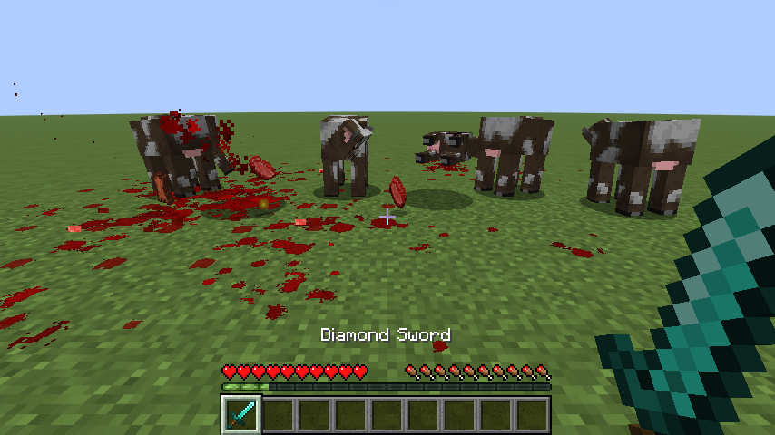

# Fluid Gore

**Silver-age Minecraft as a butcher's yard.** A client-side Fabric mod for Minecraft Java **26.3** that gives every
blow weight and every animal a death of its own: wounds that open where you strike and deepen with each blow, limbs
and heads hacked off, blood that sprays, pools and runs downhill, and animals that scream, panic and remember.

> **Content note:** this mod shows graphic, realistic violence against animals. That is its point: at Extreme it
> shows plainly what a kill costs the animal. The Gore Level and Suffering sliders scale it down to something mild,
> or switch it off.


Everything is visual and local to your game. The mod adds no blocks, items, entities, packets or registry entries, so
it works on **vanilla servers** and nobody else needs it installed. It never changes health, damage, drops, AI or game
rules.

## Features

### Strike any part of the body
Blows are tested against the animal's real model, not its hitbox, and land exactly where you aimed: a leg, the neck,
the head, the flank. Each blow on the same spot deepens the wound through four layers: **bruise, gash, open meat,
bone**. Wounds are drawn on the model itself, so they move with every step, on living animals mid-fight and on bodies
after death. Open wounds drip, so a wounded animal leaves a trail.


- **Weapons cut differently.** Fists and clubs bruise and crush but barely break the skin, so a beating bleeds
  little outside, and after enough of it the animal bleeds from the mouth and nose instead. A flint scrapes ragged,
  shallow cuts; swords cut; axes chop deep and wide; a pickaxe digs in and knocks bits of fat, meat and bone out
  like mining; arrows and spears punch small, deep holes; animals bite. Each has its own sound.
- **Hack it off.** A blade through a wound that cannot get any deeper takes that limb or the head off. The body keeps
  a raw stump; the piece keeps its gashes and shows meat around bone where it was cut.
- **Flesh by species.** Ordinary animals bleed red. Husks are dried leather that splits to a sickly, poison-coloured
  ooze. Skeletons never bleed: they scuff, crack, chip into shards and shatter.


### Explosions
A blast is graded the way a real one is, by how close each body was and how much of it the blast could see (the
same measure the game uses for explosion damage, with the real radius of the TNT, creeper or bed):
- **Point blank:** the body is gone. It bursts into hundreds of pieces of muscle, fat, bone, gut, organs, the
  rumen's half-digested grass and hide cut from the animal's own skin, in the proportions a real body is made of.
  The side that took the fireball is seared black. A red mist hangs where it stood.
- **Close:** two to four limbs or the head torn off and thrown, the belly ripped open so the gut and organs spill,
  and the rest thrown up and out like a doll, over walls and out of pits. Dead before it lands.
- **Further off:** shrapnel wounds on the side facing the blast, thrown hard, and a slower death.

Wet pieces smear the walls they hit; some stick there for a while before they peel off and drop. Meat rains down
with a patter of wet slaps and the clatter of bone. Medium gore level and up; never players.

### Every animal is an individual
- **Its own voice and nerve.** Each animal's personality is fixed by its species and identity: voice pitch, how loud
  and long it screams, how quickly it panics, stoic or frantic. Two cows never scream or die alike.
- **Screams** are built from each animal's own vanilla sounds, pitch-bent, layered and re-triggered into screams,
  whimpers, gurgles and panicked bellows.
- **Nine ways to die, the way animals really do**, picked by where and with what the killing blow landed and by the
  animal itself: stunned (drops like a sack, lies rigid, then the legs paddle on their own), bled out (stands swaying
  while its blood pumps out into a growing pool, then sinks onto its chest), the death run (bolts blind and crashes
  nose first), the downer (down on its chest, head against its flank, trying again and again to get up), a broken
  back (drags itself on its front legs), drowning in blood (coughs it up with every breath), gut-shot (curls over the
  wound), agonal thrashing after a beating, and brain hurt (walks in circles, ends on its back with its legs in the
  air). A beheaded body still runs. Each one answers a blow in its own way while it dies. Then laboured breaths, and
  the last one. One death in twenty ends with the body bursting apart when it finally goes.
- **Bodies stay.** The body outlives the server's entity: it falls, is thrown along the killing blow, and can still
  be struck, shoved and cut where it lies.



### Mothers and their young
Hurt a calf and it cries for its mother, and she answers: her head comes up and turns to the cries, and she shakes.
A dying calf keeps calling for her, thinner and weaker each time, until its last breath. Then there is a moment of
silence, and she starts to call.

She grieves for minutes, not seconds: head hung, turned to where it happened, calling to it again and again in a long
low call that breaks in the middle. She goes on long after the body is gone, less often and more quietly as time
passes. Kill a mother and her calf is left calling for her. Killing the young weighs on the whole herd far longer
than killing a grown animal.

### The herd responds
No messages and no lectures; the world responds. Animals near a slaughter tremble, look around wildly and bellow, and
it gets worse with every kill. They remember for the session: survivors cower, keep their distance and stand over
bodies; mothers and young call for each other; wolves and foxes take interest in fresh blood; bodies draw flies.
All of it is pose, sound and particles; real animal behaviour is untouched.


### Blood that behaves like a fluid
Droplets fly with gravity and splat on floors and walls. Puddles flow to lower ground, pool in dips, run down stairs
and drip off ledges. Arterial spurts pump in pulses. Blood dries and darkens, rain washes it away, footprints track
through it, and a sponge or brush scrubs it off.

## Demos
Every feature has a short scene you can play in game, set up right in front of you: type `/gore demo` for the
list (click one to play it), or `/gore demo <name>`. `pit` digs a 5x5 pit of pigs and lights a TNT in it;
`weapons`, `hack`, `headless`, `beating`, `grief`, `personalities`, `bones` and `launch` show the rest.
`/gore demo stop` ends one, `/gore demo clear` removes what demos summoned.

Demos summon animals with ordinary commands, so they need cheats (singleplayer: Open to LAN, Allow Cheats) or
operator rights on a server. Nothing is needed on the server itself. The `pit` demo digs and blows up the ground,
so it asks you to click once more before it does.

## Install

1. Install [Fabric Loader](https://fabricmc.net/use/) **0.19.5+** for Minecraft **26.3** and
   [Fabric API](https://modrinth.com/mod/fabric-api) (0.162.0+26.3 tested).
2. Put `fluidgore-<version>.jar` in your `mods` folder (`%APPDATA%\.minecraft\mods` on Windows).
3. Optional: [Mod Menu](https://modrinth.com/mod/modmenu) for a config button in the mod list.

Open the settings from **Options → Fluid Gore...** (top-left button) or from Mod Menu. Changes apply immediately and
are saved to `config/fluidgore.json`.

Tested alongside Sodium, Iris (without a shader pack), Lithium, FerriteCore, Entity Culling and ImmediatelyFast.


## Settings

| Setting | Default | What it does |
|---|---|---|
| Gore Level | Medium | Off / Low / Medium / High / Extreme. Scales blood, puddles, how often parts come off, how long it all stays, and how deep wounds go: Low stops at gashes, Medium at open meat, High and Extreme reach the bone. **Off** disables everything and clears existing blood and parts. |
| Affect Players / Mobs / Animals | On | Who bleeds. Mobs are hostile mobs; Animals is everything else that isn't a player. |
| Blood Color / Mob Blood | Red | Blood of players and passive creatures / of hostile mobs. Red, Dark Red, Green, Yellow, Blue, Purple, Black. |
| Style | Redstone | **Redstone**: blocky pixel-art splats like redstone dust. **Realistic**: smooth round splats. **Mixed**. |
| Gore Chunks | On | Heavy hits and kills throw crumbs and bits of meat. |
| Arterial Spurts | On | Bad wounds and stumps pump blood in pulsing jets. |
| Gore Sounds | On | Wet crunches and the weapon-specific impact sounds. |
| Persistence | 180 s | How long blood stays at Medium before fading (scaled by Gore Level). |
| Max Blood Decals | 1500 | Cap on splats and puddle cells; the oldest go first. |
| Wall Splatter | On | Blood sticks to walls and runs down ledges. |
| Bloody Footprints | On | Anything walking through a puddle leaves footprints. |
| Rain Washes Blood | On | Rain fades blood much faster. Blood in water always disperses. |
| Scrub Blood | On | Hold a sponge, wet sponge or brush and hold use on blood to wipe it away. Sneak to use the item normally. |
| Fluid Cells/Tick | 64 | Fluid simulation budget per tick. Lower it on a weak CPU. |
| Max Droplets | 600 | Cap on flying droplets. |
| Max Flesh Pieces | 3000 | Cap on the small pieces of flesh and bone from blasts, picks and axes. The oldest go first. |
| Part Lifetime | 60 s | How long severed parts stay at Medium (scaled by Gore Level). |
| Max Severed Parts | 32 | Cap on loose parts; the oldest go first. |
| Play With Parts | On | Punch severed parts, pick them up and throw them, kick them by walking into them, stomp them flat. |
| Blast Gore | On | Explosions shred, tear open and throw bodies by how close they were (see Explosions). |
| Wounds | On | The hit-zone and wound system described above. |
| Wounds on Monsters | Off | Wounds on hostile mobs too. |
| Wounds on Players | Off | Wounds on other players, on your screen only. |
| Suffering | Medium | Screams, trembling, death throes and herd panic, separate from Gore Level. Off disables it. |
| Scream Volume | 100% | Also follows the Friendly Creatures volume. |
| Max Screams | 8 | Sounds playing at once; background whimpers and bellows are dropped first. |
| Herd Panic | On | Animals near a slaughter tremble and bellow. |
| Personalities | On | Every animal has its own voice, nerve and way of dying. |
| Ecology | On | Animals remember killing and react by role: prey, herds, mothers, predators, flies. |
| Grief | 600 s | How long a mother grieves for her killed young (and a young animal for its mother), at Medium suffering. 0 turns it off. |
| Death Launch | 100% | How hard the killing blow throws a body. 0 turns it off. |
| Body Lingers | 10 s | How long a body stays after its death throes. |
| Red Death | On | Dying bodies stay red until they are gone, like the vanilla death. |
| Death Pop | On | Some bodies, when they finally go, pop into their head, limbs and scraps of flesh, which you can kick about. |
| Death Pop Chance | 5% | How many deaths end in that burst; the rest die one of the nine realistic deaths and are left lying. |

Only in `config/fluidgore.json`:

- `sufferingAnimals`: which animals scream and get death throes (farm animals, horses, llamas, camels, rabbits,
  wolves, foxes, cats). Deleting the entry restores the defaults.
- `boneEntities`: bony mobs that crack instead of bleeding (skeletons, strays, wither skeletons, bogged, parched,
  skeleton horses).
- `bloodlessEntities`: entities that never bleed (golems, armor stands, blazes, ...).
- `bladedItems`: what counts as a blade, as item ids (`minecraft:iron_sword`) or tags (`#minecraft:swords`). Default:
  all swords and axes.
- `cleaningItems`: what scrubs blood.
- `heavyHitDamage` (6.0): a non-lethal hit this strong can cut a part off a mob, which keeps walking without it.

## How it works

- **No server needed.** Vanilla servers already send a damage event (who hit whom) and every entity's health. The
  mod pairs the two to see each hit. When you swing, it records where your aim met the model at that moment (the
  damage packet arrives a tick later, after knockback has moved the legs).
- **Hit zones.** The ray is tested against the cubes of the entity's own model, posed exactly as it is drawn this
  frame, so it works for any mob built from model parts, modded ones included.
- **Wounds** are stored in each model part's own space and drawn right after the model, inside the same part
  transforms, so they follow the animation without any extra work.
- **Fluid.** Each puddle is a per-block cell with a volume that flows to lower neighbours, within a fixed per-tick
  budget. Decals are cut into pieces that sit on the real surface heights of stairs and slabs.
- **Bodies** are small physics systems (gravity, block collision, toppling, springy joints, weight from body size)
  that keep going after the server has removed the entity.

## Building from source

Needs **JDK 25**.

```
./gradlew build              # jar in build/libs/
./gradlew runClient          # development client
./gradlew runClientGameTest  # automated in-game test, singleplayer and dedicated server
```

The game test plays through the mod (kills, wounds, severing, babies, grief, fluid flow, settings screens) and saves
screenshots to `build/run/clientGameTest/screenshots`. Textures are generated, not drawn:
`java tools/GenerateTextures.java src/main/resources/assets/fluidgore`.

## Known limitations

- An item held in a severed hand still renders where the hand was.
- Mobs with unusual models (slimes, fish, ghasts) bleed but have no parts to lose.
- Not yet verified with an Iris shader pack enabled.

## License

[MIT](LICENSE)
