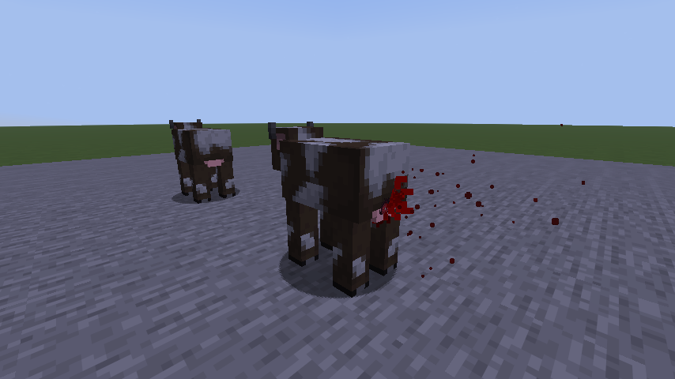

# Fragment contacts

When a Cobble Tank bursts, its casing fragments do not roll random wounds on everyone nearby. The server traces each
piece in a straight line: it stops at the first solid block or the first body in its way, and only bodies it reaches
are hurt. Every player then sees the wound where that piece struck, and a body behind a wall or behind another body is
spared. This system arrived in 3.5. The tank is a registered block, so the server and every player need the same
Fluid Gore jar.

## Seeing it

`/gore demo fragments` bursts a tank between two groups of cows: one group in the open, the other behind stone. The
pressure wave is kept small so the contact wounds and the cover are easy to read. A cow in the open can still be
missed; a hit is never guaranteed. The demo changes terrain and needs cheats, so use a creative test world.

## Server path

`fragment/FragmentTrace` takes a list of launches (direction, travel range, damage, visual material). `scatter`
makes reproducible directions from a private seeded stream, independent of world randomness. Each path finds the
nearest living body before the first solid block. A fragment that hits a body stops there; it never passes through
into another body or a further wall. Candidates are ordered by distance, then UUID, so a replay traverses them the
same way.

Bounds:

- at most 256 paths per call, tested against at most 128 candidate bodies (nearest first);
- travel range capped at 96 blocks; the default tank uses up to 192 paths (`fragmentRayBudget`) and 48 blocks
  (`tankFragmentRange`), both reduced further by the pressure left in the tank;
- the traversal walks a chunk grid and stops before an unloaded column. It never generates terrain or breaks blocks.

Each `FragmentPath` stores its index, end point and material. A body contact also stores the entity id and UUID, the
hit point in the body's own yaw frame, the incoming direction in that frame, and the damage. The server tests entity
bounding boxes, not render models or organs.

`TankBurst` gathers every record before it applies damage. It sends the wave strength and the paths, then uses one
vanilla explosion to apply the pressure damage plus every contact to each body in a single damage call. The explosion's
reach is widened to include contacts outside the pressure wave, but its damage and knockback are computed so that the
wider reach does not make the pressure blast any bigger. The visual chips never deal damage of their own.

## Packet and client path

`net/VesselBurstPayload` (`fluidgore:vessel_burst`) carries the source position, wave data, the fragment seed, a delivery id and
the paths. End points are floats relative to the source, so they keep their precision far from the world origin. The
codecs reject oversized arrays, duplicate fragment indices, unknown materials, non-finite or out-of-range coordinates
and malformed body contacts. Even 256 body contacts fit in under 32 KiB.

`FragmentEffects` drops a delivery it has already seen, while still accepting a separate burst with the same geometry
and seed. It remembers the last 64 deliveries and clears everything when the world changes. A body contact waits up
to ten client ticks for the matching UUID and model, which guards against entity-id reuse and packets arriving out of
order.

`Wounds.fragment` projects each contact onto the posed model, with its own seed and FRAGMENT attribution in the event
trace, so it produces the usual wound feedback and evidence. With Gore Level Off the debris still flies but no wounds
are drawn.

`FragmentRenderer` draws up to 512 chips with vanilla black wool, iron and stone textures. They fly along the
recorded straight paths with world lighting, stop at the recorded end point and fade quickly. The flight is a short
picture of a trace the server has already resolved: it is not a second simulation and does not time any damage.

## Limits

- The counts and ranges above are gameplay budgets, not measured fragmentation data.
- A dense crowd can have more bodies in range than the 128 candidates tested.
- Hits are tested against body boxes on the server and projected onto the drawn model on the client. A piece that
  passes through a gap in the model can hurt the body without leaving a visible wound. There is no simulation of
  penetration inside the body.
- The optional 2x2-TNT pressure vessel (off by default) still uses the older random fragment wounds; the crafted tank
  uses traced contacts.
