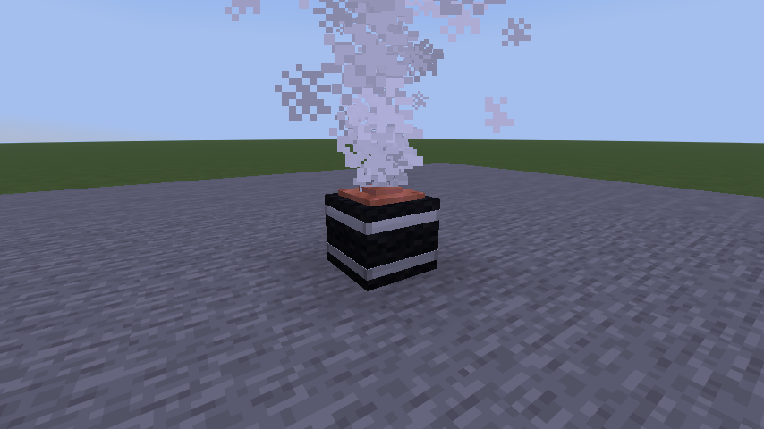

# Cobble Tank

The Cobble Tank is an optional block: a high-pressure gas tank with a dark fibre casing, metal bands and a copper
fitting. You can vent it through a valve, send it flying on its own jet, or heat it until it ruptures. Unlike the rest
of Fluid Gore it deals real damage, breaks glass and opens doors, so it is a registered block: **the server and every
player need the same Fluid Gore jar.** The default tank holds 600 litres at 10,000 psi (690 bar). The casing was
redesigned in 3.4, and since 3.5 its fragments are traced paths (see [Fragment contacts](FRAGMENT_CONTACTS.md)).

## Using it

- Craft it from one TNT surrounded by four cobblestone (a plus shape), or `/give @s cobbletank:cobble_tank`.
- Use it with an empty hand to read its pressure, shell temperature, cut damage and heat damage.
- Sneak-use it with an empty hand to pick it up. This only works while it is full, undamaged, unlit and at ambient
  temperature, and it keeps its contents.
- Sneak-use a stick to open a valve on the face you click. Gas leaves through that face and the recoil pushes the
  other way: a valve on top presses the tank down, one on a side can send it skidding and tumbling.
- Tools scar and cut the casing. A pierced liner leaks before the damage adds up to a rupture.
- Fire, lava and lit campfires next to it heat the casing. Take the heat away early and it cools, but damage done to
  the casing stays, and a hot shell keeps heating the gas for a while after the fire is gone.
- Redstone, flint and steel, a fire charge or a burning projectile starts a countdown. This trigger is a game
  convenience, separate from failure by fire, and the countdown carries on if the tank is flying.
- `/gore demo roadster` shows the casing, a valve jet lifting cow organs and a rupture by fire near cows.
  `/gore demo tank` shows leaking, flight and the trigger. Both change terrain, so use a creative test world.

## Settings

All of these are server settings (the Cobble Tank section of the Fluid Gore settings, or `config/cobbletank.json`). A placed tank keeps the size and
wave coupling it was placed with.

| Setting | Key | Default | Range |
| --- | --- | --- | --- |
| Cobble Tank Volume | `tankLitres` | 600 litres | 10-2000 |
| Cobble Tank Pressure | `tankPsi` | 10,000 psi | 500-20,000 |
| Tank Heat-Up Time | `tankFireSeconds` | 12 | 4-120 |
| Tank Blast Wave Coupling | `tankWavePercent` | 35% | 1-100 |
| Tank Fragment Range | `tankFragmentRange` | 48 blocks | 4-96 |
| Cobble Tank Breaks Glass | `tankBreaksGlass` | On | |

## How it works

The Cobble Tank is an add-on with its own jar; its code lives in `src/tank/` (package `dev.fluidgore.cobbletank`,
common unless noted). The physics it shares with the gore are Fluid Gore's: `physics/Blast`, `physics/GasJet` and
`fragment/`. The server owns gas loss, shell and gas temperatures, the casing's
remaining strength, flight and damage; clients only draw it.

- **State.** `TankState` keeps the fill fraction, nominal pressure and volume, casing damage, crack area, gas and shell
  temperatures, permanent heat damage, wave coupling and a running countdown. All of it is saved, survives flight and
  settling, and is synced to clients. A flying `TankEntity` carries its own pressure and volume, so a viewer's local
  settings never change what it does.
- **Venting.** The valve and cracks use an orifice model with choked and subcritical flow, finite mass loss and
  ideal-gas cooling as the gas expands. The shell has its own thermal inertia and exchanges heat with the gas.
- **Flight.** `TankEntity` moves under bounded thrust and torque, gravity, drag, ground friction and impacts.
  `TankBlockEntity` decides when the thrust is enough to lift or slide the block.
- **Jets.** A jet (`GasJet`) stops at solid blocks. Bodies, shaped organs and small scraps in the open cone are pushed; pieces a
  player is holding are left alone. The same contact geometry serves server damage and client pieces.
- **Rupture.** `Blast.energy` is the ideal isentropic expansion energy of the gas. `TankState.waveKg` takes the wave
  coupling share of it and feeds the TNT-based pressure and impulse model that every explosion in the mod uses. The
  rest of the energy is not a second explosion. `TankBurst` damages nearby tanks by their exposure, so tanks do not
  always set each other off. The gas gives no fireball: the burst shows white condensation fog, mild surface chill and
  casing debris. An outside fire stays its own heat source. Long contact with a cold casing uses vanilla freezing.
- **Network.** The server sends Fluid Gore's `net/VesselBurstPayload` (wave strength, seeded fragment paths, body contacts) before the
  vanilla explosion that applies the damage, so every client draws the same burst. Fluid Gore's `net/VesselBursts` plays
  it; the add-on's `client/TankClient` only clears the block first.

## Limits

- The numbers are gameplay calibration, not measured data. At the default preset the tank behaves as if it held
  250 kg of gas in a 150 kg casing; heating times, loss of shell strength and injury bands are tuned the same way.
  There is no real-gas equation of state and no structural model of the casing.
- The 35% wave coupling is a game choice.
- Stored-energy TNT equivalence is not the same as the blast wave of a detonation.
- The pressure wave uses a simple cover factor. It does not model reflections, diffraction or flow inside rooms.
- Thrust, friction and impacts in flight are approximate.

## References

- NASA Glenn Research Center, *Beginner's Guide to Propulsion*:
  [Mass flow choking](https://www.grc.nasa.gov/www/k-12/BGP/mflchk.html) (educational page). Basis for the choked
  orifice flow.
- Sandia National Laboratories, publication comparing
  [side-on peak overpressure predictions and measurements](https://www.sandia.gov/research/publications/details/comparison-of-side-on-peak-overpressure-predictions-and-measurements-for-ty-2022-12-12/)
  for composite pressure vessel bursts. On how a tank's stored energy differs from a detonation's pressure wave.
